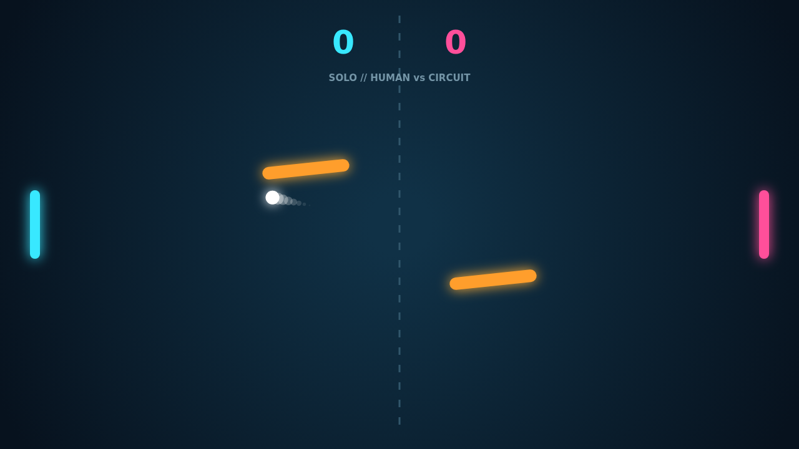

# Carom

Carom turns the familiar paddle duel into a game of angles. Every rally begins
from center court, but the two swaying, spinning bars quickly turn a clean return
into a bank-shot puzzle.

Move through contact and the ball carries your paddle's motion as spin. A flat
shot can curl after it leaves you, dip into an obstacle, and escape along a line
your opponent did not expect. The bright trail makes every bend readable.

Solo play pits the left paddle against the reactive Circuit. Versus puts both
sides on one keyboard. Either way, the pace climbs with every return and a match
runs to 11, win by two—so a close match keeps tightening until someone earns a
real break.

